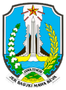

<p align="center">
  
</p>

<h1 align="center">SIKP Malang Selatan</h1>

<p align="center">
  <b>Sistem Informasi Ketahanan Pangan Malang Selatan</b><br>
  Portal data pembangunan Bakorwil III Malang, Pemerintah Provinsi Jawa Timur
</p>

<p align="center">
  <a href="https://sikp-malang-selatan.vercel.app"></a>
  
  
  
  
</p>

---

## Daftar Isi

1. [Ringkasan](#1-ringkasan)
2. [Struktur Bidang & Modul](#2-struktur-bidang--modul)
3. [Fitur Utama](#3-fitur-utama)
4. [Pengguna & Hak Akses](#4-pengguna--hak-akses)
5. [Alur Aplikasi](#5-alur-aplikasi)
6. [Teknologi](#6-teknologi)
7. [Instalasi & Menjalankan](#7-instalasi--menjalankan)
8. [Akun Bawaan](#8-akun-bawaan)
9. [Perintah Artisan Tambahan](#9-perintah-artisan-tambahan)
10. [Menambah atau Mengubah Modul Data](#10-menambah-atau-mengubah-modul-data)
11. [Format Import Excel](#11-format-import-excel)
12. [Deploy ke Vercel](#12-deploy-ke-vercel)
13. [Struktur Folder](#13-struktur-folder)
14. [Catatan Penting untuk Developer](#14-catatan-penting-untuk-developer)
15. [Mengatasi Masalah Umum](#15-mengatasi-masalah-umum)

---

## 1. Ringkasan

SIKP Malang Selatan adalah aplikasi web untuk **mengumpulkan, mengelola, dan mempublikasikan data pembangunan** dari seluruh bidang di Bakorwil III Malang. Data dicatat per kecamatan di **9 kecamatan Malang Selatan**:

> Ampelgading · Bantur · Dampit · Donomulyo · Gedangan · Kalipare · Pagak · Sumbermanjing Wetan · Tirtoyudo

Aplikasi terdiri dari dua bagian:

| Bagian | Pengguna | Akses |
|---|---|---|
| **Situs publik** (`/`, `/data`) | Masyarakat, instansi, pimpinan | Terbuka **tanpa login**. Menampilkan ringkasan, indikator, tabel, dan grafik seluruh bidang. Hanya-baca. |
| **Panel pengelola** (`/admin`) | Administrator & Petugas Bakorwil III | Wajib login. Untuk input, ubah, hapus, import, dan export data sesuai hak akses. |

Data yang diinput petugas langsung tampil di situs publik, sehingga informasi yang disajikan selalu sesuai kondisi terbaru.

**Versi live:** https://sikp-malang-selatan.vercel.app

## 2. Struktur Bidang & Modul

Data disusun berjenjang: **Bidang → Sub Bidang → Modul**. Saat ini terdapat **4 bidang, 8 sub bidang, dan 31 modul data**.

| Bidang | Sub Bidang | Modul |
|---|---|---|
| **Pemerintahan** | Pemerintahan I | Rekap Kependudukan, Data Desa/Kelurahan, Statistik & Kominfo, Perpustakaan & Kearsipan |
| | Pemerintahan II | Trantibumlinmas, Kesbangpol, Kerja Sama Daerah, Batas Wilayah |
| **Pembangunan Ekonomi** | Pembangunan Ekonomi I | UMKM & Koperasi, Investasi, Perdagangan & Industri |
| | Pembangunan Ekonomi II | Pertanian & Perkebunan, Peternakan, Perikanan, Ketahanan Pangan |
| **Kemasyarakatan** | Kemasyarakatan I | Pendidikan, Kesehatan, Sosial, Tenaga Kerja & Transmigrasi |
| | Kemasyarakatan II | PPPA, KB, Kepemudaan & Olahraga, Budaya & Pariwisata |
| **Sarana & Prasarana** | Sarpras I | Proyek Infrastruktur (PUPR), Perumahan & Permukiman, Pertanahan, Perhubungan |
| | Sarpras II | Kawasan Hutan, Lahan Kritis, Lingkungan Hidup, ESDM |

Ada dua jenis modul:

- **Rekap**: satu baris data untuk setiap kecamatan per periode (bulan, semester, atau tahun). Contoh: jumlah sekolah dan siswa per kecamatan tahun 2026. Persentase dan status capaian target dihitung otomatis.
- **Daftar**: kumpulan entri bebas, misalnya daftar proyek infrastruktur atau perjanjian kerja sama, lengkap dengan pencarian dan filter.

Struktur bidang diatur di [config/bidang.php](config/bidang.php), sedangkan isi setiap modul diatur di [config/modul_data.php](config/modul_data.php).

## 3. Fitur Utama

**Situs publik (tanpa login)**
- Landing page berisi statistik keseluruhan, kelengkapan data per bidang, sorotan indikator terbaru beserta status capaian target, pembaruan terbaru, dan cakupan data per kecamatan
- Halaman **Data Bidang** untuk menjelajahi setiap bidang, sub bidang, dan modul
- Tabel, kartu metrik, dan grafik per kecamatan untuk setiap modul, dengan filter periode

**Panel pengelola (login)**
- Dashboard sesuai role. Petugas langsung melihat modul yang menjadi tugasnya.
- Input, ubah, dan hapus data dengan validasi otomatis (misalnya jumlah bagian tidak boleh melebihi total)
- Lampiran dokumen pendukung (PDF/Excel/Word) per data
- **Export Excel** di semua modul, **import Excel** untuk Kawasan Hutan dan Lahan Kritis
- Kelola akun pengguna dan **penugasan petugas per bidang/sub bidang**

**Umum**
- Tampilan responsif (desktop dan ponsel), Bahasa Indonesia, zona waktu WIB
- Halaman error (403, 404, 419, 429, 500, 503) dengan desain yang konsisten
- Login dibatasi 5 percobaan per menit

## 4. Pengguna & Hak Akses

Aplikasi memiliki **dua role**: Administrator dan Petugas. Masyarakat tidak memerlukan akun.

| Fitur | Administrator | Petugas | Masyarakat |
|---|:---:|:---:|:---:|
| Melihat landing page & Data Bidang | ✅ | ✅ | ✅ |
| Login ke panel pengelola | ✅ | ✅ | ❌ |
| Tambah & ubah data | ✅ Semua bidang | ✅ Sub bidang tugas | ❌ |
| Hapus data | ✅ Semua bidang | ✅ Sub bidang tugas | ❌ |
| Import & export Excel, unduh lampiran | ✅ Semua bidang | ✅ Sub bidang tugas | ❌ |
| Kelola akun pengguna & penugasan | ✅ | ❌ | ❌ |
| Ubah profil & password sendiri | ✅ | ✅ | ❌ |

Ketentuan penting:

- **Penugasan petugas.** Administrator menugaskan setiap petugas ke satu atau beberapa sub bidang. Di panel pengelola, petugas hanya melihat dan mengelola sub bidang tugasnya. Sub bidang lain tidak muncul di menu dan tidak bisa dibuka lewat URL.
- **Pembatasan di sisi server.** Hak akses diperiksa oleh middleware (`role:` dan `bidang:` di [routes/web.php](routes/web.php)), tidak sekadar dengan menyembunyikan tombol.
- **Keamanan akun Administrator.** Administrator tidak dapat menurunkan role akunnya sendiri, sehingga sistem selalu memiliki minimal satu Administrator.
- **Tanpa pendaftaran mandiri.** Akun baru hanya dibuat oleh Administrator melalui menu **Pengguna → Tambah Pengguna**.

## 5. Alur Aplikasi

### Alur pengguna

```
SITUS PUBLIK (tanpa login)                 PANEL PENGELOLA (login di /login)
──────────────────────────                 ─────────────────────────────────
Beranda (/)                                Dashboard (/admin)
 ├─ statistik & sorotan indikator           ├─ ringkasan sesuai role
 ├─ pembaruan terbaru & cakupan wilayah     ├─ Bidang → Sub Bidang → Modul
 └─ Data Bidang (/data)                     │    lihat · tambah · ubah · hapus · export
     └─ Bidang (/data/{bidang})             ├─ Pengguna* : akun & penugasan
         └─ Modul (/data/{bidang}/{modul})  └─ Profil Saya : nama, email, password
            tabel · metrik · grafik         (* khusus Administrator)
```

### Siklus data

```
Petugas/Admin input data  →  Validasi  →  Database  →  Cache ringkasan diperbarui  →  Tampil di situs publik
```

### Alur teknis permintaan

```
Browser
  → routes/web.php          menentukan controller untuk URL
  → Middleware              auth, role (admin/petugas), bidang (penugasan)
  → Controller              mengambil dan mengolah data
  → Model / Support         akses database dan perhitungan (ModulData, RingkasanBidang)
  → View (Blade)            menyusun halaman HTML
  → Browser
```

## 6. Teknologi

| Bagian | Teknologi |
|---|---|
| Backend | Laravel 10, PHP 8.1+ |
| Database | PostgreSQL (Supabase) untuk produksi, MySQL untuk pengembangan lokal |
| Excel | [maatwebsite/excel](https://laravel-excel.com) |
| Frontend | Blade, CSS kustom (tanpa framework CSS), JavaScript |
| Grafik | Chart.js |
| Build aset | Vite |
| Ikon & font | Bootstrap Icons, Inter (dipasang lewat npm) |
| Hosting | Vercel (runtime `vercel-php`) |

## 7. Instalasi & Menjalankan

### Kebutuhan

- **PHP 8.1+** dengan extension `pdo_pgsql` (Supabase) atau `pdo_mysql` (MySQL), serta `gd`, `zip`, `mbstring`, `fileinfo`
- **Composer**
- **Node.js 18+** dan npm
- Di Windows disarankan memakai [Laragon](https://laragon.org)

> **Memakai Supabase di Laragon?** Extension `pdo_pgsql` dan `pgsql` umumnya belum aktif. Aktifkan melalui menu Laragon **PHP → Extensions**, atau hapus tanda `;` di depan `extension=pdo_pgsql` dan `extension=pgsql` pada `php.ini`.

### Langkah instalasi

```bash
# 1. Ambil kode
git clone https://github.com/rehanindafriy/sikp-malang-selatan.git
cd sikp-malang-selatan

# 2. Pasang dependency
composer install
npm install

# 3. Siapkan konfigurasi
cp .env.example .env           # Windows (CMD): copy .env.example .env
php artisan key:generate

# 4. Atur koneksi database di .env (lihat di bawah)

# 5. Buat tabel dan akun bawaan
php artisan migrate --seed

# 6. (Opsional) isi data contoh agar tampilan tidak kosong
php artisan data:dummy

# 7. Build aset tampilan
npm run build

# 8. Jalankan server
php artisan serve
```

Buka **http://127.0.0.1:8000**. Biarkan terminal `php artisan serve` tetap terbuka selama aplikasi digunakan.

### Pengaturan database di `.env`

**Pilihan A: Supabase (database produksi)**

Isi `.env` produksi diperoleh dari pengelola project melalui jalur pribadi. **Jangan pernah meng-commit file `.env`.**

```env
DB_CONNECTION=pgsql
DB_HOST=aws-0-ap-southeast-2.pooler.supabase.com   # host "Session pooler" dari dashboard Supabase
DB_PORT=5432
DB_DATABASE=postgres
DB_USERNAME=postgres.<project-id>
DB_PASSWORD="<password database>"                   # gunakan tanda kutip bila ada spasi atau #
DB_PERSISTENT=true                                  # pakai ulang koneksi agar lebih cepat
```

> Gunakan **Session pooler**, bukan *Direct connection*. Koneksi langsung Supabase umumnya hanya melalui IPv6 dan sering gagal di jaringan rumah atau kantor.

**Pilihan B: MySQL lokal (pengembangan & pengujian)**

Nyalakan MySQL di Laragon, buat database kosong (misalnya `ketahanan_pangan`), lalu:

```env
DB_CONNECTION=mysql
DB_HOST=127.0.0.1
DB_PORT=3306
DB_DATABASE=ketahanan_pangan
DB_USERNAME=root
DB_PASSWORD=
```

### Mode pengembangan tampilan

Jalankan `npm run dev` di terminal kedua bersamaan dengan `php artisan serve` agar perubahan CSS/JS langsung terlihat. Setelah selesai, jalankan `npm run build`.

## 8. Akun Bawaan

Dibuat oleh `php artisan migrate --seed` ([DatabaseSeeder.php](database/seeders/DatabaseSeeder.php)):

| Role | Email | Password awal |
|---|---|---|
| Administrator | `admin@bakorwil3.jatimprov.go.id` | `GantiPasswordIni123` |
| Petugas (Sub Bidang Sarpras II) | `petugas@bakorwil3.jatimprov.go.id` | `PetugasBakorwil123` |

> ⚠️ **Segera ganti password** melalui menu **Profil Saya** setelah login pertama, karena password awal tercantum di kode.
>
> - Menjalankan ulang `php artisan db:seed` akan **mengembalikan password Administrator** ke nilai awal. Cara ini dapat dipakai bila lupa password.
> - Akun Petugas yang sudah ada **tidak** diubah oleh seeder.

## 9. Perintah Artisan Tambahan

| Perintah | Fungsi |
|---|---|
| `php artisan data:dummy` | Mengisi data contoh yang realistis ke seluruh modul. Data asli tidak ditimpa: periode yang sudah berisi data dilewati. |
| `php artisan data:dummy --hapus` | Menghapus **hanya** data contoh (ditandai sumber data "Data contoh (dummy)"). Data asli tidak terhapus. |
| `--force` | Tambahkan pada kedua perintah di atas untuk melewati konfirmasi. |

Jalankan `php artisan data:dummy --hapus` setelah data asli mulai diinput agar data contoh tidak tercampur dengan data resmi.

## 10. Menambah atau Mengubah Modul Data

Sebagian besar modul disimpan di tabel bersama `modul_data` (kolom JSON), sehingga **menambah atau mengubah field tidak memerlukan migration**:

1. Tambahkan atau ubah definisi modul di [config/modul_data.php](config/modul_data.php): field, satuan, total, persentase dan target, metrik, tabel, serta grafik. Panduan lengkap setiap opsi tertulis di bagian atas file tersebut.
2. Daftarkan modul di [config/bidang.php](config/bidang.php) pada sub bidang yang sesuai, dengan `'status' => 'aktif'` dan `'data' => '<kunci modul>'`.

Halaman daftar, form input, validasi, kartu metrik, grafik, status target, situs publik, dan export Excel akan terbentuk otomatis.

## 11. Format Import Excel

Import Excel tersedia untuk **Kawasan Hutan** dan **Lahan Kritis**. Baris pertama file harus berisi **nama kolom persis** seperti di bawah (huruf kecil, memakai garis bawah). Ukuran file maksimal 2 MB. Cara termudah mendapatkan template: klik **Export Excel**, lalu gunakan file hasilnya.

### Kawasan Hutan

| Kolom | Wajib | Contoh |
|---|:---:|---|
| `kabupaten` | ✅ | Kabupaten Malang |
| `kecamatan` | ✅ | Dampit |
| `nama_kawasan` | ✅ | RPH Dampit |
| `jenis_kawasan` | ✅ | Hutan Lindung |
| `desa` | | Sukodono |
| `luas_ha` | | 1250.75 |
| `keterangan` | | Dikelola Perhutani |

Data dengan kombinasi `kabupaten` + `kecamatan` + `nama_kawasan` yang sudah ada akan **diperbarui**, bukan digandakan.

### Lahan Kritis

| Kolom | Keterangan |
|---|---|
| `kabupaten` | Opsional, bawaan "Kabupaten Malang" |
| `kecamatan` | **Wajib**, salah satu dari 9 kecamatan Malang Selatan dengan penulisan persis (misalnya `Sumbermanjing Wetan`) |
| `dalam_sangat_kritis`, `dalam_kritis`, `dalam_agak_kritis`, `dalam_potensial_kritis`, `dalam_tidak_kritis` | Luas (Ha) **di dalam** kawasan hutan |
| `luar_sangat_kritis`, `luar_kritis`, `luar_agak_kritis`, `luar_potensial_kritis`, `luar_tidak_kritis` | Luas (Ha) **di luar** kawasan hutan |

- Kolom luas yang kosong dianggap 0, dan **total dihitung otomatis**.
- Satu kecamatan berisi satu data. Kecamatan yang sudah ada akan **diperbarui**.

> Tulis angka **tanpa titik ribuan**, misalnya `1500.75`, bukan `1.500,75`.

## 12. Deploy ke Vercel

Konfigurasi deploy ada di [vercel.json](vercel.json) dan [api/index.php](api/index.php) (runtime `vercel-php`, region Sydney agar dekat dengan database Supabase).

1. Atur **Environment Variables** di dashboard Vercel: `APP_KEY`, `APP_URL`, `DB_HOST`, `DB_USERNAME`, `DB_PASSWORD`. Variabel lain sudah ditetapkan di `vercel.json`.
2. Deploy dari folder project:
   ```bash
   npx vercel --prod
   ```
3. Migration **tidak** dijalankan otomatis. Bila ada migration baru, jalankan `php artisan migrate` dari komputer lokal dengan `.env` yang mengarah ke Supabase, sebelum deploy.

## 13. Struktur Folder

```
app/
├── Console/Commands/DataDummy.php        perintah data:dummy
├── Http/
│   ├── Controllers/
│   │   ├── DashboardController.php       landing page & dashboard panel
│   │   ├── DataBidangController.php      situs publik /data
│   │   ├── BidangController.php          halaman bidang & modul di panel
│   │   ├── ModulDataController.php       CRUD, export, lampiran semua modul data
│   │   ├── KawasanHutanController.php    CRUD, import, export kawasan hutan
│   │   ├── LahanKritisController.php     CRUD, import, export lahan kritis
│   │   ├── UserController.php            akun & penugasan (khusus Administrator)
│   │   ├── ProfileController.php         profil & ganti password
│   │   └── AuthController.php            login & logout
│   └── Middleware/
│       ├── RoleMiddleware.php            pembatasan per role
│       └── BidangAccess.php              pembatasan per bidang/sub bidang (penugasan)
├── Models/                               User, UserBidangAccess, ModulDataEntri, Wilayah, Lampiran, dll.
├── Support/
│   ├── Bidang.php                        struktur bidang & aturan akses
│   ├── ModulData.php                     logika modul generik (nilai, persentase, status)
│   ├── RingkasanBidang.php               ringkasan situs publik (di-cache)
│   └── RingkasanModul.php                ringkasan per modul
└── helpers.php                           angka() untuk format 12.345,67

config/
├── bidang.php                            daftar bidang, sub bidang, modul
└── modul_data.php                        definisi field & indikator setiap modul

resources/
├── css/app.css                           seluruh gaya tampilan
├── js/app.js                             grafik, animasi, dropdown
└── views/
    ├── beranda.blade.php                 landing page
    ├── data/                             situs publik Data Bidang
    ├── admin/                            panel pengelola (modul, pengguna, profil)
    ├── kawasan-hutan/ & lahan-kritis/    modul kehutanan
    ├── layouts/                          public (situs publik) & admin (panel)
    ├── components/                       komponen bersama (stat, field, page-header, dll.)
    ├── auth/                             login
    └── errors/                           halaman error

routes/web.php                            seluruh URL beserta middleware aksesnya
api/index.php, vercel.json                konfigurasi deploy Vercel
```

## 14. Catatan Penting untuk Developer

- 🔴 **Jangan menjalankan `php artisan test` bila `.env` mengarah ke Supabase.** Tes dengan `RefreshDatabase` akan **mengosongkan database produksi**. Gunakan database MySQL lokal terpisah untuk pengujian.
- 🔴 **File `.env` tidak boleh di-commit.** File ini sudah tercantum di `.gitignore`.
- **Setelah `git pull`**, jalankan `composer install`, `npm install`, `php artisan migrate`, dan `npm run build` bila ada perubahan dependency, migration, atau tampilan.
- **Database Supabase berada di Sydney**, sehingga setiap query memiliki jeda ±0,2–0,9 detik. Karena itu:
  - jumlah query per halaman dibuat seminimal mungkin;
  - ringkasan situs publik **di-cache 5 menit** dan otomatis diperbarui setiap kali data berubah;
  - `DB_PERSISTENT=true` memakai ulang koneksi database;
  - pengisian data dalam jumlah besar memakai *bulk insert*, bukan satu transaksi panjang (koneksi pooler dapat terputus).
- **Format angka**: gunakan helper `angka($nilai)` (hasil `12.345,67`) atau `angka($nilai, 0)` (hasil `12.345`).
- **Halaman panel baru**: gunakan `@extends('layouts.admin')` serta komponen yang tersedia (`<x-page-header>`, `<x-stat>`, `<x-field>`) agar tampilan seragam.
- **Pencarian** tidak membedakan huruf besar/kecil, baik di PostgreSQL maupun MySQL (`likeOperator()` di `Controller.php`).

## 15. Mengatasi Masalah Umum

| Masalah | Penyebab & solusi |
|---|---|
| `ERR_CONNECTION_REFUSED` di browser | Server belum berjalan. Jalankan `php artisan serve` dan biarkan terminalnya terbuka. |
| `could not find driver` | Extension database PHP belum aktif. Aktifkan `pdo_pgsql` (Supabase) atau `pdo_mysql` (MySQL). |
| `password authentication failed` | Password di `.env` salah, atau mengandung spasi/`#` tanpa tanda kutip. Tulis `DB_PASSWORD="..."`, lalu jalankan `php artisan config:clear`. |
| Tampilan tanpa gaya / `Vite manifest not found` | Aset belum di-build. Jalankan `npm install` lalu `npm run build`, kemudian tekan Ctrl+F5. |
| "Terlalu Banyak Percobaan" saat login | Gagal login 5 kali dalam 1 menit. Tunggu 1 menit. |
| Lupa password Administrator | Jalankan `php artisan db:seed` (password kembali ke nilai awal), lalu segera ganti melalui Profil. |
| Perubahan `.env` tidak berpengaruh | Jalankan `php artisan config:clear`. |
| Data baru belum muncul di situs publik | Ringkasan di-cache maksimal 5 menit. Jalankan `php artisan cache:clear` bila perlu segera tampil. |
| Halaman lambat dibuka | Wajar pada kunjungan pertama karena database berada di Sydney. Kunjungan berikutnya lebih cepat. |

---

<p align="center">
  © Bakorwil III Malang · Pemerintah Provinsi Jawa Timur
</p>
